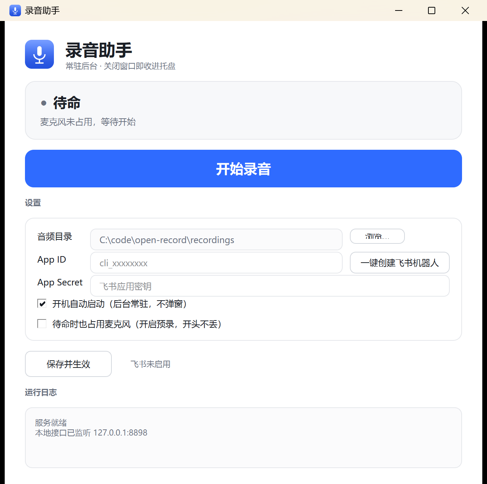

# 录音助手

**一个纯本地运行的录音工具。启动一次，之后一直在。**

点一下开始，点一下停止，录音自动存到你自己指定的目录。没有云端、没有账号、不联网也能用。

> **唯一会联网的地方是飞书远程控制（可选功能，默认关闭）。** 开启后，你主动发「停止」时
> 它会把当次 mp3 上传到飞书服务器发回给你。不配飞书，全程不联网。详见 [隐私说明](#隐私说明)。



---

## 目录

- [为什么开源](#为什么开源)
- [启动一次，之后就一直在](#启动一次之后就一直在)
- [三个真实场景](#三个真实场景)
  - [场景一：人不在场，电脑在场](#场景一人不在场电脑在场)
  - [场景二：开会或访谈，当场录下来](#场景二开会或访谈当场录下来)
  - [场景三：手机上遥控电脑录音](#场景三手机上遥控电脑录音)
- [下载与安装](#下载与安装)
- [日常使用](#日常使用)
- [托盘图标](#托盘图标)
- [录音参数](#录音参数)
- [隐私说明](#隐私说明)
- [法律声明](#法律声明)
- [常见问题](#常见问题)

---

## 为什么开源

录音软件是个很敏感的东西。

它要一直占用你的麦克风，它录下来的东西可能包含别人的谈话、公司的会议、家里的私事。
市面上这类软件，多数要么强制登录账号，要么默认把录音传到厂商服务器，你根本不知道它到底录了什么、传了什么。

**所以这个工具开源。** 代码全在这里，你可以自己看它到底做了什么——
它没有上传逻辑，没有埋点，没有账号体系。你觉得它可疑，就自己翻代码；翻完觉得还行，再用。

开源不是因为它做得多好，是因为**录音这件事本身就让人不安，闭源用着更不安**。

---

## 启动一次，之后就一直在

这是这个工具最核心的设计：**你只需要主动启动它一次。**

```
第一次双击「启动录音助手.bat」
        ↓
自动写入开机自启（当前用户注册表，不需要管理员权限，不弹 UAC）
        ↓
之后每次开机：静默驻留右下角托盘，不弹窗、不占任务栏
        ↓
要用的时候：点托盘图标 / 右键菜单 / 飞书发一句 / 本地接口
```

**你不需要每次都去找那个 bat 文件。** 开机它就自己在了。

> 想关掉自启：右键托盘图标 → 取消勾选「开机自启」，或在界面里取消勾选后点「保存并生效」。
> 想彻底退出：右键托盘图标 → 退出。**关闭窗口 ≠ 退出**，关窗只是收进托盘，录音服务继续跑。

---

## 三个真实场景

### 场景一：人不在场，电脑在场

**这是最容易想到、也最实用的用法。**

比如：你要去开一个两小时的会，但笔记本得留在工位上继续收别的东西；
或者你要出门，但有件事需要录下来——隔壁工位的讨论、某个设备的异响、一场你没空参加的线上会议。

做法很简单：

1. 出门前，点一下「开始录音」（或在飞书里发一句「开始」）
2. 走人
3. 回来点「停止录音」，mp3 已经在 `recordings\` 里了

它有一个 **`max_hours` 保护（默认 6 小时）**，就算你忘了停，到点也会自己停，不会把硬盘录满。

> **⚠️ 这一条有法律风险，必须自己判断清楚。**
> 「人不在场时自动或远程录音」在很多司法辖区高度敏感，可能违反当地关于通信秘密、
> 隐私权或职场监控的规定。**录之前先确认你所在地区的法律，以及你有没有权利录这段内容。**
> 本工具只提供技术能力，不为你的录音行为承担任何责任。详见 [法律声明](docs/LEGAL.md)。

磁盘要按峰值算：录音期间约 **330MB/小时**，收尾成 mp3 后约 **84MB/小时**。录 6 小时约需 2GB 临时空间。

### 场景二：开会或访谈，当场录下来

不想一边听一边记，就先录下来回头整理。

- 会前点「开始录音」，会后点「停止录音」
- 界面上的**实时电平**会跟着说话跳，跳说明真的录进去了
- 托盘图标**变红**，不打开窗口也知道在录

录音结束后在 `recordings\日期\` 下生成 mp3，文件名直接是录音区间：

```
recordings\2026-11-04\20261104_110536-110547.mp3
                    └ 日期     └ 开始时间-结束时间
```

一眼能看出是哪一段，不用重命名。

> 本工具**不做语音转文字**，这是刻意选择不是没做完（原因见 [常见问题](#常见问题)）。
> 需要文字稿，把这个 mp3 交给专业转写服务即可。

### 场景三：手机上遥控电脑录音

人已经出门了，但想临时录一段电脑那边的声音——用飞书。

配置一次飞书机器人（可选功能，不配也能正常用），之后在手机上：

| 你发 | 它做 |
|---|---|
| 「开始」/「录音」/「录一下」 | 开始录音 |
| 「停止」/「结束」/「好了」 | 停止，**把 mp3 文件直接发回这个聊天窗** |
| 「状态」 | 查看已录多久、当前电平 |
| 「取消」/「不要了」 | 丢弃本次录音 |

不用背命令，说话就行。指令到达约 0.5 秒。

配置步骤见 [日常使用 → 飞书](#飞书可选)。

---

## 下载与安装

### 推荐：下载分发包

到 [Releases](https://github.com/cattei/open-record/releases) 下载 `open-record-YYYYMMDD.zip`（**含内置运行时，解压即用**）。

> **⚠️ 注意：仓库里的 `Download ZIP` 不含运行时。**
> `runtime\` 约 134MB，体积太大被 `.gitignore` 排除了，不在仓库里。
> 从 GitHub 直接 `Download ZIP` 解压出来**没有** `runtime\python\python.exe`，
> 双击 bat 只会提示「找不到内置 Python 运行时」。想要解压即用请下 Releases。

### 安装三步

1. **解压整个文件夹**（必须保留全部子目录，不要只把 bat 或某个 exe 拷出来）
2. 双击 **`启动录音助手.bat`**
3. 完事。首次运行会自动设为开机自启

解压后的目录应该长这样：

```
open-record\
├── 启动录音助手.bat        ← 双击这个
├── app\                    ← 程序代码
├── runtime\
│   └── python\             ← 内置 Python 运行时（约 134MB，别删）
├── recordings\             ← 录音文件存这里
└── config.json             ← 配置（首次运行后生成）
```

### 从源码运行

需要 Python 3.11+ 和 `PySide6`、`numpy`、`sounddevice`、`lameenc`（飞书功能另需 `lark_oapi`）。

```bat
pip install PySide6 numpy sounddevice lameenc lark_oapi
python app\launcher.py
```

想自己打包出分发包，跑 `packaging\` 里的脚本。

---

## 日常使用

### 界面

| 区域 | 作用 |
|---|---|
| 状态卡片 | 待命 / 录音中（含计时与实时电平） |
| 开始录音 | 开始录制 |
| 停止录音 | 停止并自动生成 mp3 |
| 音频目录 | 录音保存位置，点「浏览…」可改 |
| App ID / Secret | 飞书凭据，填了才启用远程控制 |
| 开机自动启动 | 勾选后随系统启动（**默认已勾选**） |
| 保存并生效 | 改完配置点这个，立即生效，无需重启 |

> 录音进行中「保存并生效」会自动禁用——保存会重启服务，重启路径会丢掉正在写的录音。先停止再保存。

### 托盘图标

图标颜色就是状态：**蓝色 = 待命，红色 = 录音中**。鼠标悬停能看到实时计时。

| 操作 | 效果 |
|---|---|
| 单击图标 | 打开界面 |
| 右键 → 显示界面 | 同上 |
| 右键 → 开始/停止录音 | **不打开窗口也能录** |
| 右键 → 开机自启 | 勾选/取消自启 |
| 右键 → 打开录音目录 | 跳转到录音文件夹 |
| 右键 → 退出 | **真正退出** |
| 关闭窗口 | 收进托盘，录音不受影响 |

> Win11 默认会把新图标塞进 `^` 溢出区。本程序首次运行会自动把它提到可见区，
> 一般不需要你手动去 `^` 里翻。

### 飞书（可选）

想在手机上遥控电脑录音，配置一次：

1. 点界面上的 **「一键创建飞书机器人」** 按钮，跟着向导走
2. 向导会自动打开飞书开放平台、复制应用名、列出必须开通的两项权限
3. 你在网页上点几下建好应用，把 App ID / Secret 粘回来
4. 点「校验并启用」——**它会真的调一次飞书服务器验证凭据**，错了当场告诉你原因

> **诚实说明**：飞书**没有**「用接口创建应用」的 API，所以这一步没法全自动。
> 向导负责的是除了网页点几下之外的所有事（打开页面、复制应用名、列权限、粘回来、
> 真调一次服务器验证凭据），但应用本身必须你在网页上点出来。
> 按钮叫「一键创建」是因为位置有限，别理解成点一下就能全自动建好。

必须开通的两项权限：`im:message`（接收消息）、`im:message:send_as_bot`（发送消息）。

> 不填凭据时程序**不会加载**飞书组件，内存占用更低。

---

## 录音参数

配置文件 `config.json`，改完重启程序生效。

| 键 | 默认 | 说明 |
|---|---|---|
| `recordings_dir` | `recordings` | 保存目录，相对路径相对程序目录，也可写绝对路径 |
| `always_on_mic` | false | 待命期间是否常驻占用麦克风。false 时不占设备（其他软件可随时用），代价是预录失效 |
| `prebuffer_sec` | 15 | 预录秒数。**仅在 `always_on_mic=true` 时真正生效** |
| `chunk_sec` | 30 | 分片时长，断电最多丢这么久 |
| `max_hours` | 6 | 单次录音上限，防止忘记停止占满磁盘 |
| `mp3_bitrate` | 192 | mp3 码率，48kHz 单声道。可选 96/128/160/192/256/320 |
| `gain` | 12.0 | 软件增益倍数。声音小调大，太吵调小 |
| `exclusive` | false | true 为独占麦克风（其他软件不能同时用） |
| `autostart` | true | 开机自启 |

### 关于预录：默认不占麦克风

待命时程序**不打开麦克风**，这样其他软件（会议、语音输入）随时能用，不会被挡住。
代价是点「开始录音」到设备真正开流之间的声音无法补录，实际只能并入约 0.2 秒。

如果你更在意「开口第一句不能丢」，把 `always_on_mic` 设为 `true`：
待命期间就保持开流并持续填充环形缓冲，点击后能真正并入 `prebuffer_sec` 秒。
**注意**此时麦克风被常驻占用，其他软件可能无法同时录音。

---

## 隐私说明

**默认状态：完全不联网。** 没有账号、没有埋点、没有上传逻辑，录音只写在你指定的目录里。

有两处**需要你自己主动开启**的例外，开不开由你决定：

| 例外 | 会发什么出去 | 什么时候发 |
|---|---|---|
| 飞书远程控制（默认关闭） | 当次录音的 **mp3 文件** | 你在飞书里发「停止」时，上传到飞书服务器再发回该聊天 |
| 语音转写（默认关闭） | 音频分片 | 开启 `transcribe: true` 且装了 `faster-whisper` 后，按所选模型处理 |

> 开了飞书，你的录音就不再「只在本机」了——它会经过飞书服务器。
> 这是飞书这个功能本身的代价，不是程序偷偷传的。不配飞书就完全没有这条路径。

另外，程序在本机监听一个 HTTP 控制接口（`127.0.0.1:8898`），默认只绑回环地址、只能本机访问。
**如果你把 `config.json` 里的 `http.host` 改成对外地址、又留着空 token，等于把控制权开放给局域网。**
真要改，请同时设置 `http.token`。

---

## 法律声明

**本项目面向个人使用。作者不欢迎、不授权任何商业使用**——包括但不限于商业销售、
作为付费服务或产品的一部分、预装进商业软硬件、用于商业外包交付。

**录音行为本身的法律责任完全由使用者承担。** 录音是否合法取决于你所在地的法律和具体场景
（是否需要对方同意、是否涉及商业秘密、职场与教育场景的特殊规定等）。
「人不在场时自动或远程录音」在很多司法辖区高度敏感。本工具只提供技术能力，不提供法律意见。

> **关于 MIT 与「不商用」的关系，如实说明：** 本仓库的 `LICENSE` 是标准 MIT，
> MIT 条款本身**允许**商业使用。上面那句「不授权商业使用」是作者的明确意愿与请求，
> **不构成 MIT 的附加条件**。两者冲突时，法律上站得住的是 MIT，但作者不欢迎。
> 确有商用需求，请先通过 Issue 联系作者取得书面许可。

完整条款见 **[docs/LEGAL.md](docs/LEGAL.md)**。

---

## 常见问题

**Q：双击 bat 后窗口闪一下就没了？**

解压不完整。确认 `runtime\python\python.exe` 存在。或者你下的是仓库 ZIP（不含运行时）。

**Q：关掉窗口程序就退出了吗？**

没有。关窗只是收进托盘，录音服务继续跑。要真正退出，右键托盘图标 → 退出。

**Q：托盘图标不见了？**

Win11 会把它收进 `^` 溢出区。本程序首次运行会自动提到可见区；
如果仍看不到，在「设置 → 任务栏 → 其他系统托盘图标」里设为常显。

**Q：怎么彻底卸载？**

右键托盘图标 → 退出 → 取消勾选「开机自动启动」→ 删掉整个文件夹。
（自启只写了一个注册表值 `HKCU\...\Run\ProjectRecord`，取消勾选即清除。）

**Q：为什么不做语音转文字？**

本地 whisper 模型在普通麦克风录音上术语识别率只有 0-5%，输出大量同音错字，实际不可用。
与其给一个看起来能用但需要反复校对的结果，不如不做。
代码里保留了转写模块（`app/asr.py`），需要可自行装 `faster-whisper` 后开启 `transcribe: true`。

**Q：录音有杂音 / 听不清？**

笔记本内置麦克风远场拾音天生弱，已在解码时放大 12 倍补偿。仍偏小就调大 `gain`。
远场录音的物理限制无法用软件完全弥补，外接麦克风提升明显。

**Q：杀毒软件报警？**

Python 打包，未做数字签名。若被拦，添加信任或检查源码后使用。源码全在 `app\` 目录。

**Q：支持 Mac / Linux 吗？**

不支持。依赖 Windows 音频 API，仅支持 Windows。

---

## 更多材料

| 想做什么 | 看这里 |
|---|---|
| 完整图文使用指南（含全部截图） | [promo/guide/使用指南.html](promo/guide/使用指南.html) |
| 10 步交互动画演示（双击就能看） | [promo/demo/index.html](promo/demo/index.html) |
| 更详细的开发文档、参数与已知限制 | [docs/README.md](docs/README.md) |
| 变更记录 | [docs/CHANGELOG.md](docs/CHANGELOG.md) |
| 依赖说明 | [docs/DEPENDENCIES.md](docs/DEPENDENCIES.md) |

---

## 许可

代码使用 [MIT License](LICENSE)。商用限制与录音法律责任见 [docs/LEGAL.md](docs/LEGAL.md)。
