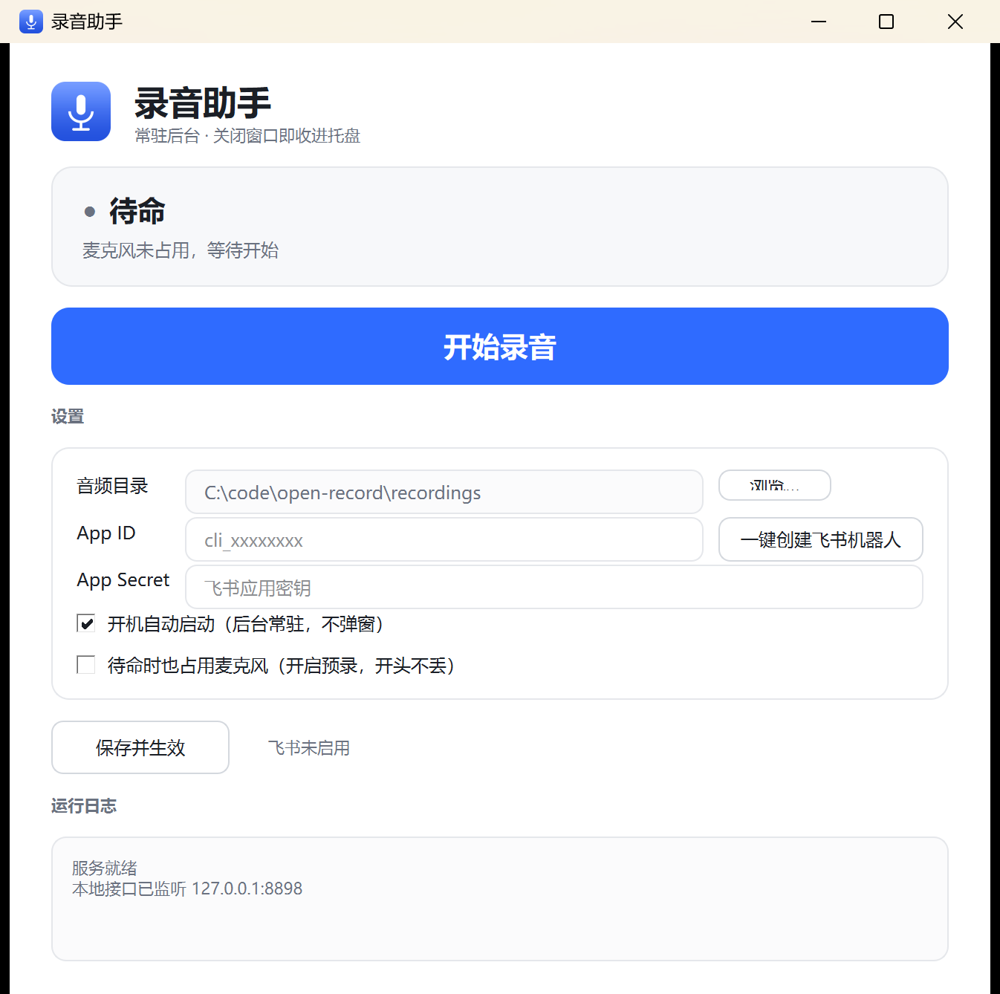
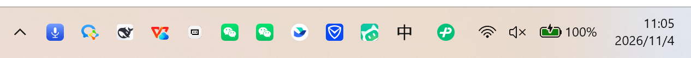
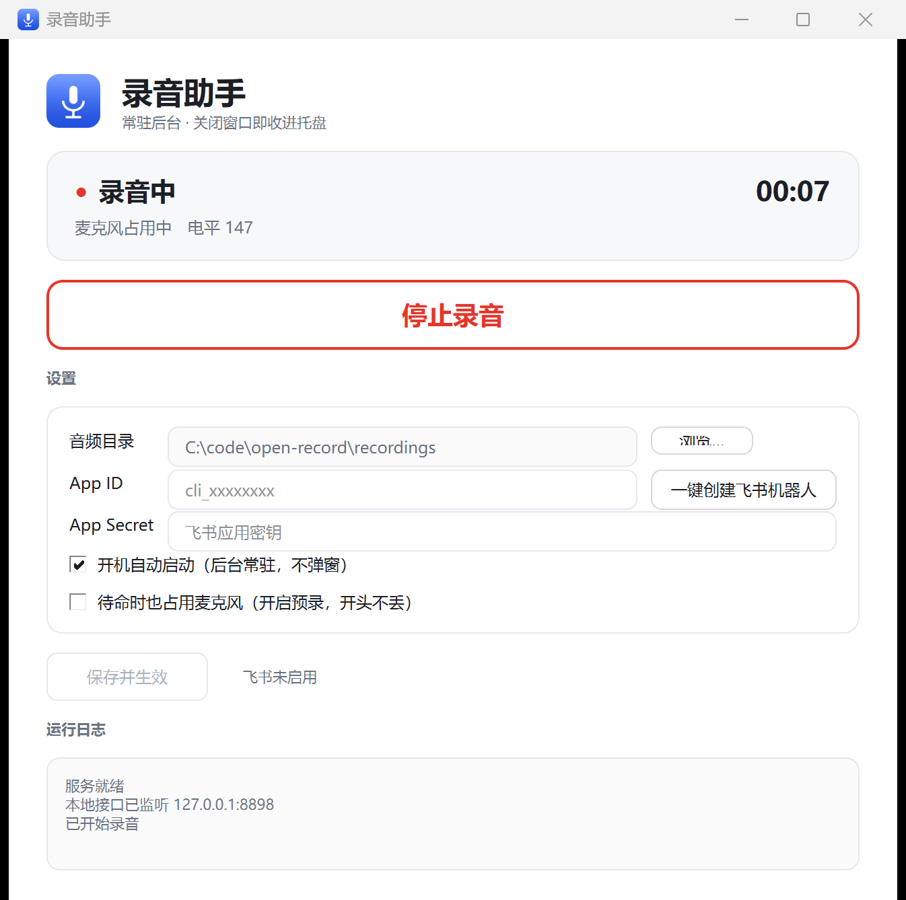
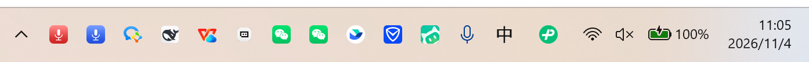
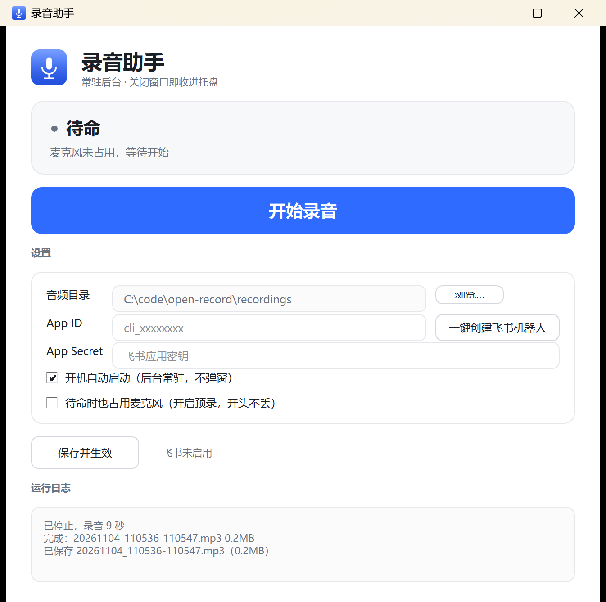
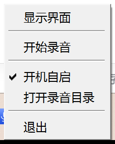
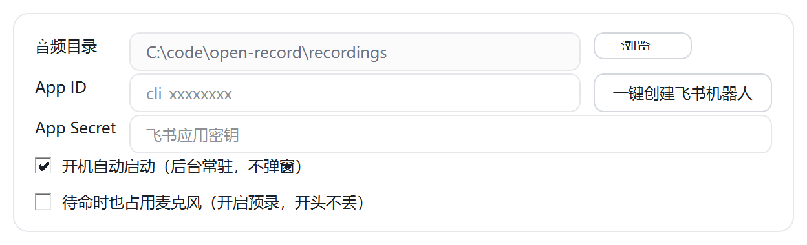
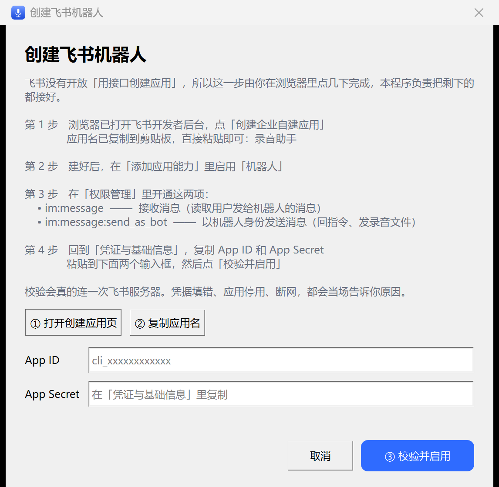
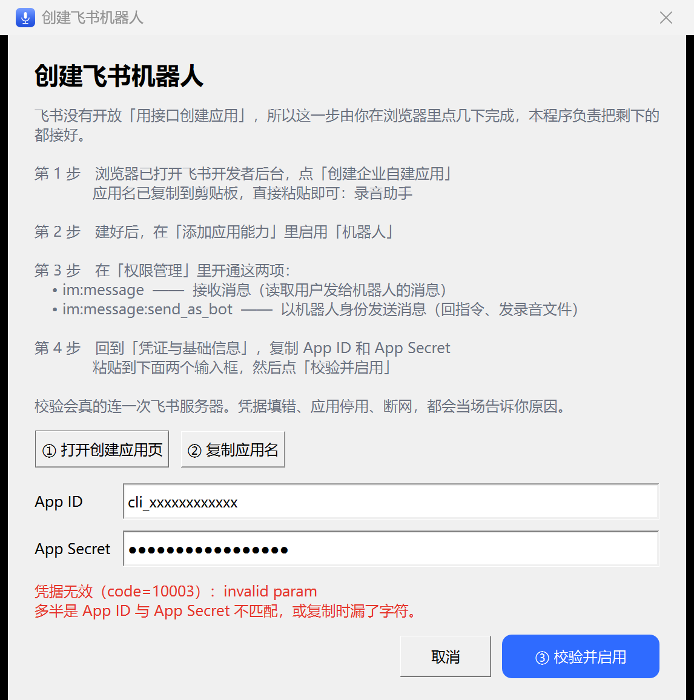

# 录音助手 使用指南

> 一个**纯本地运行**的录音工具。点一下开始，点一下停止，录音自动存到你自己指定的目录。
> 没有云端、没有账号、不联网也能用。飞书远程控制是可选功能。



---

## 这是什么，适合谁

适合这些场景：

- **开会、访谈、讲座**：不想一边听一边记，先录下来，回头整理
- **灵感随手记**：脑子里冒出个想法，点一下就录，不用开一堆软件
- **不想把录音传到别人服务器**：默认状态下所有音频只留在本机

它的三个特点：

| 特点 | 具体是什么 |
|---|---|
| **无感** | 首次运行自动设为开机自启，之后常驻右下角托盘，不占任务栏、不弹窗 |
| **纯本地** | 默认状态下录音不经过任何服务器。只有你主动启用飞书远程控制时，发「停止」才会把当次 mp3 上传到飞书服务器发回给你；不开就完全没有这条路径 |
| **不用装环境** | 运行时（Python + 依赖）已内置在 `runtime\` 里，解压即用 |

---

## 一、下载与安装

### 1. 下载代码包

打开项目主页：

```
https://github.com/cattei/open-record
```

点绿色的 **`Code`** 按钮 → **`Download ZIP`**，下载到本地。

> ⚠️ **先说清楚一件事：仓库里的 ZIP 不含内置运行时。**
>
> `runtime\` 目录约 134MB，体积太大，被 `.gitignore` 排除了，不在仓库里。
> 所以直接 `Download ZIP` 解压出来的包里**没有** `runtime\python\python.exe`，
> 双击 bat 只会提示「找不到内置 Python 运行时」。
>
> **想解压即用，请下载 Releases 里的分发包**（`open-record-YYYYMMDD.zip`，含 runtime）。
> 想从源码自己跑，见本节末尾「从源码运行」。

### 2. 解压（这一步最容易出错）

**必须解压整个文件夹，保留全部子目录。** 不要只把 `启动录音助手.bat` 或某个 exe 单独拷出来。

解压后目录结构应该像这样（**关键：`runtime\python\python.exe` 必须在**）：

```
open-record\
├── 启动录音助手.bat        ← 双击这个
├── app\                    ← 程序代码
├── runtime\
│   └── python\             ← 内置 Python 运行时（约 134MB，别删）
├── docs\
├── recordings\             ← 录音文件会存在这里
└── config.json             ← 配置（首次运行后生成）
```

> **为什么强调这一点**：程序依赖 `runtime\` 里的 Python 和 `app\` 里的代码。
> 只拷一个 bat 出去，双击后会提示「找不到内置 Python 运行时」。

### 3. 双击启动

双击 **`启动录音助手.bat`**。

首次启动会做两件事：

1. 把程序注册为**开机自启**（写入当前用户的注册表，**不需要管理员权限**，不会弹 UAC）
2. 在右下角托盘区显示图标，然后窗口打开

之后每次开机，程序会静默驻留托盘，不再弹窗。

> bat 的逻辑很简单：优先用 `runtime\python\pythonw.exe`（不带黑窗）启动
> `app\launcher.py`；找不到 pythonw 就退回 `python.exe`；两个都没有才报错。

### 4. 从源码运行（可选）

如果你下的是仓库 ZIP（没有 runtime），或者想自己控制 Python 环境：

**需要 Python 3.11+ 和这几个包**：`PySide6`、`numpy`、`sounddevice`、`lameenc`。
想用飞书功能还要 `lark_oapi`（可选，不装也能用其它功能）。

```bat
pip install PySide6 numpy sounddevice lameenc lark_oapi
python app\launcher.py
```

也可以用仓库里的构建脚本自己造一份 runtime：

```bat
python packaging\build_runtime.py   :: 从本机环境抽取 runtime\python
python packaging\package.py         :: 组装 dist\open-record\ 并打 zip
```

详见 `packaging\README.md`。

> 注意：`app\launcher.py` 启动时会自检依赖（PySide6 / sounddevice / numpy / lameenc），
> 缺任何一个都会弹框提示「缺少运行依赖……请重新解压完整发行包」。

---

## 二、第一次启动会看到什么

### 主界面


界面从上到下三块：

| 区域 | 内容 |
|---|---|
| 状态卡片 | 当前状态（待命 / 录音中 / 处理中），录音时右侧显示计时 |
| 大按钮 | 「开始录音」蓝色实心；录音时变成红色描边的「停止录音」 |
| 设置 + 运行日志 | 音频目录、App ID / Secret、两个勾选项、保存按钮、日志 |

状态卡片下方那行小字是 **「麦克风未占用，等待开始」**——待命时程序**不打开麦克风**，
所以其它软件（会议、语音输入）随时能用，不会被它挡住。

### 托盘图标出现

启动后，任务栏右下角会出现一个**蓝色麦克风图标**。



Win11 有个习惯：新出现的托盘图标默认被塞进 **`^`** 溢出区。本程序启动时会**自动把图标提升到可见托盘区**，所以你通常能直接在任务栏上看到它，不用去 `^` 里翻。

> 万一还是没看到（比如被安全软件拦了注册表写入），点 `^` 展开，把图标拖到任务栏即可。
> 程序的运行日志里也会提示这一点。
>
> 非 Windows 11 系统（没有对应的注册表项）会自动跳过这段逻辑，图标本来就正常显示。

### 关闭窗口 ≠ 退出

点窗口右上角的 **×**，窗口只是**收进托盘**，程序继续在后台运行。

这是刻意设计的：录音工具应该随手可用，而不是每次都重新启动。

**真正退出**只有一个入口：右键托盘图标 → **退出**。

---

## 三、录一段

### 开始

点界面里的大按钮 **「开始录音」**，或者在托盘右键菜单里点「开始录音」。

录音中界面会变：



- 顶部状态变成 **录音中**，左边有个红点
- 右边显示实时计时（如 `00:07`）
- 下面显示「麦克风占用中」和实时电平
- 大按钮变成红框的 **「停止录音」**
- 托盘图标同时变成**红色**（不用开窗口也能看出在录）



### 停止

点 **「停止录音」**。程序会做四件事：

1. 停采集、先释放麦克风（其它软件马上就能用）
2. 把这次录音的分片合并成一个 **mp3**
3. 做音量归一：**只在录音明显过轻时才放大**（峰值低于约 -24dBFS 才动手，
   最高 12 倍；介于正常区间则原样不动，避免把噪声一起放大；判定为静音则完全不处理）
4. 删掉中间分片，成品存到 `recordings\日期\` 下，文件名带起止时间

界面底部日志会给出结果：



日志三行的真实文案（就是上图里那三行）：

```
已停止，录音 9 秒
完成：20261104_110536-110547.mp3 0.2MB
已保存 20261104_110536-110547.mp3（0.2MB）
```

> 录音期间程序会分片写盘（默认每 30 秒一片），所以**即使中途断电或崩溃**，
> 已经写好的分片也还在，最多丢最近 30 秒，不会整段丢光。
> 分片在成功合成 mp3 后立即删除。

### 录音文件在哪

默认在 `recordings\<日期>\` 下，完整路径形如：

```
recordings\2026-11-04\20261104_110536-110547.mp3
                       └ 日期_开始时间-结束时间
```

文件名直接反映录音区间，一眼能看出是哪一段。

想改目录：界面上「音频目录」一栏点 **浏览…** 选新目录，再点 **「保存并生效」**。

> **「保存并生效」在录音期间是禁用的**（按钮变灰）。因为保存会重启录音服务，
> 而重启路径会丢掉正在写的分片。改配置请先停止录音。
>
> 改 `config.json` 手写的话，改完要**重启程序**才生效。

---

## 四、托盘图标怎么用

| 操作 | 效果 |
|---|---|
| **单击** | 打开界面（窗口被收起来时，点一下就回来） |
| **右键** | 弹出菜单，见下 |



右键菜单五项：

| 菜单项 | 作用 |
|---|---|
| 显示界面 | 和单击一样 |
| 开始录音 / 停止录音 | 不打开窗口直接录，菜单文字随状态变 |
| 开机自启 | 打勾=开机自动启动；取消勾选后不再自启 |
| 打开录音目录 | 在资源管理器里打开录音文件夹 |
| **退出** | 真正退出程序（这是唯一入口） |

---

## 五、可选：接入飞书，用聊天控制录音

不开也能正常用。开了之后，可以在飞书里发一句话控制这台电脑录音。

### 它能做到什么

在飞书里给机器人发消息：

| 你发 | 它做 |
|---|---|
| 开始 / 录音 / 录一下 / 记一下 | 开始录音（回一条「已开始录音 + 会话号」）|
| 停止 / 停 / 结束 / 好了 / 可以了 | 停止并**把 mp3 文件直接发回聊天窗** |
| 状态 / 多久 / 还在录吗 | 回当前已录时长与电平 |
| 取消 / 不要了 / 删掉 | 丢弃这次录音 |

指令很宽松，不用背命令。发别的话会回一条用法提示。

> 停止后回传的是**音频文件本身**，不是文字稿——本工具不做转写（见文末说明）。
> 如果某次录音全程电平极低，机器人会在消息里多提醒一句「这段大概率没采到声音」。

### 怎么配：点「一键创建飞书机器人」

在设置区 **App ID** 那一行右边，有一个 **「一键创建飞书机器人」** 按钮。



点它，会弹出一个向导：



> **说清楚它做了什么、没做什么**：飞书开放平台**没有**提供「用接口创建应用」的服务端 API，
> 所以任何工具都无法真的「点一下就替你建好应用」。这个按钮做的是**把其余环节全部自动化**：
>
> - 自动打开飞书开发者后台的创建页
> - 把建议的应用名放进剪贴板，你直接粘贴
> - 明确列出必须开通的两项权限
> - 你粘贴 App ID / App Secret 后，**真的连一次飞书服务器校验**
> - 校验通过才写入配置并启用

向导里的四步：

**第 1 步**　浏览器已打开开发者后台，点「创建企业自建应用」，应用名直接粘贴（已在剪贴板）

**第 2 步**　建好后，在「添加应用能力」里启用 **「机器人」**

**第 3 步**　在「权限管理」里开通这两项：

| 权限码 | 作用 |
|---|---|
| `im:message` | 接收消息（读取你发给机器人的消息） |
| `im:message:send_as_bot` | 以机器人身份发送消息（回指令、发录音文件） |

**第 4 步**　回到「凭证与基础信息」，复制 **App ID** 和 **App Secret**，粘贴到向导里，点 **「校验并启用」**

### 校验是真的

点「校验并启用」会真的连一次飞书服务器。凭据填错会当场告诉你错在哪：



这类提示能区分几种情况，不用你自己猜：

- **App ID / Secret 不匹配或复制漏字符**（`code=10003/10014/10001`）→ 提示「多半是 App ID 与 App Secret 不匹配，或复制时漏了字符」
- **应用已停用或被管理员限制**（`code=10004/10005`）→ 提示去后台确认应用状态
- **App ID 格式就不对**（不是 `cli_` 开头）→ 本地直接拦下，告诉你重新复制
- **连不上飞书**（断网 / 代理）→ 提示「这不是凭据填写的问题」，并写明原因
- **超时 8 秒** → 提示检查网络后重试

校验通过后，程序会自动保存配置、建立长连接，界面设置区显示「飞书已启用」。

---

## 六、常见问题

### 双击 bat 后提示「找不到内置 Python 运行时」

`runtime\python\` 目录不存在或不完整。两种解法：

- 下的是**仓库 ZIP**（不含 runtime）→ 改下 Releases 里的分发包，或按「从源码运行」自己装依赖
- 下的是**分发包但解压不全** → 重新解压整个压缩包，别只拷部分文件

### 提示「缺少运行依赖」

同理：`runtime\` 被删过或没解压全。重新解压完整发行包。
**发行包里的运行时没有 pip**，所以在那个环境下 `pip install` 是跑不通的（这是设计如此）。
从源码跑的话，用你自己的 Python 环境 `pip install PySide6 numpy sounddevice lameenc`。

### 录音没声音 / 电平一直是 0

1. 先看 Windows 声音设置里麦克风是否被静音、音量是否为 0
2. 看界面「录音中」下面的**电平数字**，说话时应该在跳
3. 如果有别的软件（会议、聊天）正在占用麦克风，可能录不到——
   程序的日志里会明确写出「麦克风被占用（占用方：xxx）」
4. 勾选 **「待命时也占用麦克风」** 可以保证开头不被截断，代价是待命时也占着设备

### 右下角找不到图标

程序启动时会自动把图标提到可见区。若还是没有：

1. 点任务栏的 **`^`** 展开溢出区，找蓝色麦克风图标
2. 找到后把它**拖到任务栏**，之后就会固定显示
3. 若日志里出现「托盘图标提升失败：注册表写入被拒绝」，多半是安全软件拦了注册表写入，
   不影响录音功能，手动拖一次即可
4. 若日志里出现「托盘图标提升失败：注册表里始终没有本进程的记录」，
   说明系统托盘整体不可用（极少数情况），此时程序会**直接保持窗口可见**，
   不会变成没有任何入口的隐形进程

### 关了窗口程序还在跑？

这是**设计如此**。关窗口只是收进托盘。
要真正退出：右键托盘图标 → 退出。
（正在录音时点退出会先弹框确认，避免误丢录音。）

### 录音文件在哪、能改吗

默认 `recordings\<日期>\`。界面上「音频目录」改完记得点「保存并生效」。

### 磁盘占用大概多少

- 录音期间临时 WAV 分片：约 **330MB/小时**（48kHz，录完会删）
- 成品 mp3：约 **84MB/小时**
- 所以录 6 小时大约需要 **2GB 临时空间**
- 程序**不做自动清理**，录多少留多少

### 能录多久？会自己停吗

单次默认上限 **6 小时**（`max_hours`），到时间自动停止，防止忘记停止占满磁盘。

### 怎么彻底卸载

1. 右键托盘图标 → **退出**（真正退出，不是关窗口）
2. 打开界面，取消勾选「开机自动启动」
3. 删掉整个文件夹

自启只在注册表里写了一个值 `HKCU\Software\Microsoft\Windows\CurrentVersion\Run\ProjectRecord`，
取消勾选即清除。

### 杀毒软件 / SmartScreen 报警？

本工具是 Python + 内置官方 python.exe，**未做数字签名**，属于正常现象。
注意这里刻意没有用 PyInstaller 打包成 exe——那种自造的 exe 在 Win11 上会被
Smart App Control 直接拦死。源码全在 `app\` 目录，可自行审计。

---

## 附：命令行用法

给需要自动化/调试的人（路径按发行包结构；从源码跑就把 `runtime\python\python.exe`
换成你自己的 `python`）：

```bat
:: 只进托盘，不弹窗（开机自启用的就是这个）
runtime\python\pythonw.exe app\launcher.py --background

:: 强制显示窗口
runtime\python\python.exe app\launcher.py --show

:: 只安装开机自启，不启动
runtime\python\python.exe app\launcher.py --install

:: 只移除开机自启
runtime\python\python.exe app\launcher.py --uninstall

:: 打印自启诊断信息（JSON）
runtime\python\python.exe app\launcher.py --status
```

> `--install` / `--uninstall` / `--status` 只处理自启，不会启动界面；
> 依赖自检也在这三个参数之后才跑，所以它们不需要完整运行时。

---

## 附：不做语音转写（说明一下为什么）

本工具**不做语音转文字**，这是刻意的取舍，不是没做完的功能。

原因：本地 whisper 模型在普通麦克风远场录音上术语识别率只有 0-5%，会输出大量
同音错字，实际不可用。与其给一个看起来能用、却要反复校对的结果，不如不做。

需要文字稿：用本工具录 mp3，再交给专业转写服务。
代码里保留了转写模块（`app\asr.py`），自己装 `faster-whisper` 后可把
`config.json` 的 `transcribe` 改成 `true` 开启。

---

## 隐私说明

- 默认状态下录音**只存在本机**，没有任何上传逻辑
- 默认**不联网**。只有你主动启用飞书功能时，才会连飞书开放平台
- **例外：启用飞书后，你发「停止」时程序会把当次 mp3 上传到飞书服务器再发回给你。**
  开了飞书，录音就不再「只在本机」——这是这个功能本身的代价，不是程序偷偷传的。
  不配飞书就完全没有这条路径
- 飞书 App Secret 存在本机 `config.json` 里，不会外发
- 代码全部开源，可自行审查

---

*本指南中的界面截图均为程序真实运行画面（Win11，2x 缩放），未做修饰。
飞书校验失败那张截图里的 `code=10003` 是真实调用飞书接口返回的结果。*
